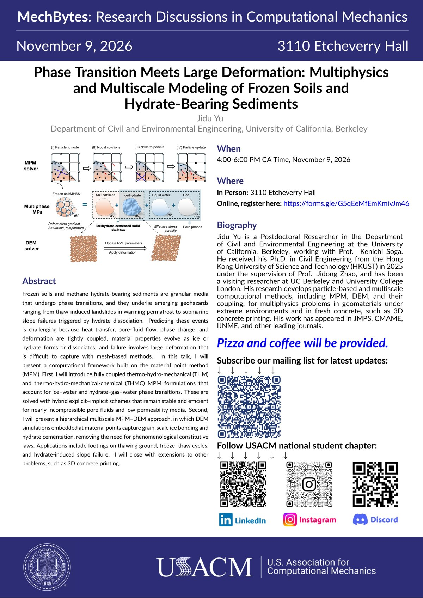

On 9 November 2026, Jidu gave an invited seminar in *MechBytes: Research Discussions in Computational Mechanics*, hosted by the USACM Student Chapter at UC Berkeley in 3110 Etcheverry Hall (4:00–6:00 PM). The talk was titled *"Phase Transition Meets Large Deformation: Multiphysics and Multiscale Modeling of Frozen Soils and Hydrate-Bearing Sediments"*.

Jidu presented a computational framework built on the material point method (MPM) for granular media that undergo phase transitions. He introduced fully coupled thermo-hydro-mechanical (THM) and thermo-hydro-mechanical-chemical (THMC) MPM formulations for ice–water and hydrate–gas–water phase transitions, and a hierarchical multiscale MPM–DEM approach in which grain-scale simulations capture ice bonding and hydrate cementation. Applications included footings on thawing ground, soils under freeze–thaw cycles and submarine slope failure triggered by hydrate dissociation.

Jidu thanks the USACM Student Chapter organizers for the invitation and the audience for the engaging discussion.
